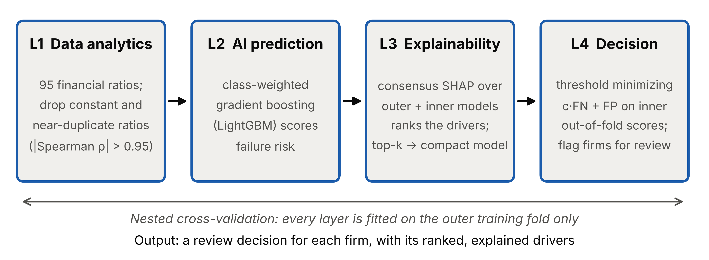

# XBP — explainable, cost-aware AI for business performance prediction

Code and data for the short communication

> **An Explainable Artificial Intelligence Framework for Data Analytics–Driven Business Performance Prediction**
> S.R. Banda — submitted to *Knowledge-Based Systems* (Elsevier).

XBP predicts corporate failure from financial ratios and turns the prediction into a
review decision that managers can audit. It chains four layers, each fitted on
training data only:

| Layer | What it does |
|---|---|
| **L1 Data analytics** | drops constant ratios and near-duplicates (\|Spearman ρ\| > 0.95) |
| **L2 AI prediction** | class-weighted gradient boosting (LightGBM) scores failure risk |
| **L3 Explainability** | **consensus SHAP**: averages normalised SHAP shares over the outer model and the inner cross-validation models, then keeps the top-k drivers as a compact model |
| **L4 Decision** | learns the threshold that minimises `c·FN + FP` from inner out-of-fold scores (exact O(n log n) search) |



## Reproduce

```bash
pip install -r requirements.txt
python xbp.py           # full study: 5-fold x 3-repeat nested CV (~11 min on 2 CPUs)
python xbp.py --quick   # smoke test: 3-fold x 1 repeat (~2 min)
```

Every table, figure and number in the paper is written to `results/` by that one
command. Seeds are fixed, package versions are pinned, and the dataset's SHA-256
checksum is verified at load time.

| Option | Default | Meaning |
|---|---|---|
| `--cost-ratio` | `10` | cost of a missed failure ÷ cost of a false alarm |
| `--sensitivity` | `5 20` | extra cost ratios reported in Table 2 |
| `--k` / `--k-main` | `5 10 20` / `10` | driver counts tried / used by XBP |
| `--folds`, `--repeats` | `5`, `3` | outer repeated stratified CV |
| `--seed`, `--jobs` | `42`, `-1` | random seed, CPU cores |

## Results

<!-- RESULTS -->

## Repository layout

```
xbp.py                 the whole method and experiment (data checks, 4 layers, nested CV, tables, figures)
data/bankruptcy.csv    UCI Taiwanese Bankruptcy Prediction dataset, unchanged
results/               table1_benchmark.csv, table2_ablation.csv, fold_metrics.csv,
                       summary.json, fig1_framework.{pdf,png}, fig2_shap_drivers.{pdf,png}
```

## Data

6,819 Taiwanese listed firms (Taiwan Economic Journal, 1999–2009), 95 financial ratios,
220 failures (3.2%). Source: Liang et al. (2016), *European Journal of Operational
Research* 252, 561–572, distributed by the UCI Machine Learning Repository,
<https://doi.org/10.24432/C5004D>, under CC BY 4.0.
SHA-256: `67bf2e7c75490f7ad3f76bbce57d49cdc25967cdab607527b94f944863fa14d8`.

## Citation

```bibtex
@software{banda2026xbp,
  author = {Banda, Shashank Reddy},
  title  = {xai-business-performance: reproducible code for XBP},
  year   = {2026},
  url    = {https://github.com/shashankreddybanda/xai-business-performance}
}
```

## Licence

Code: MIT (see `LICENSE`). Data: CC BY 4.0, from the UCI Machine Learning Repository.
