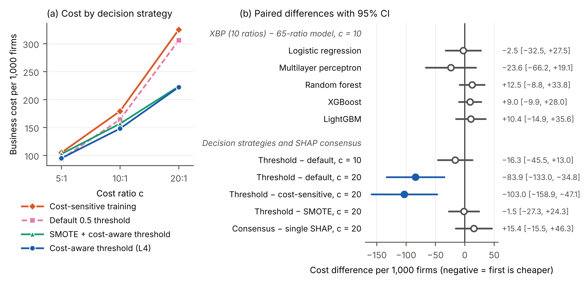
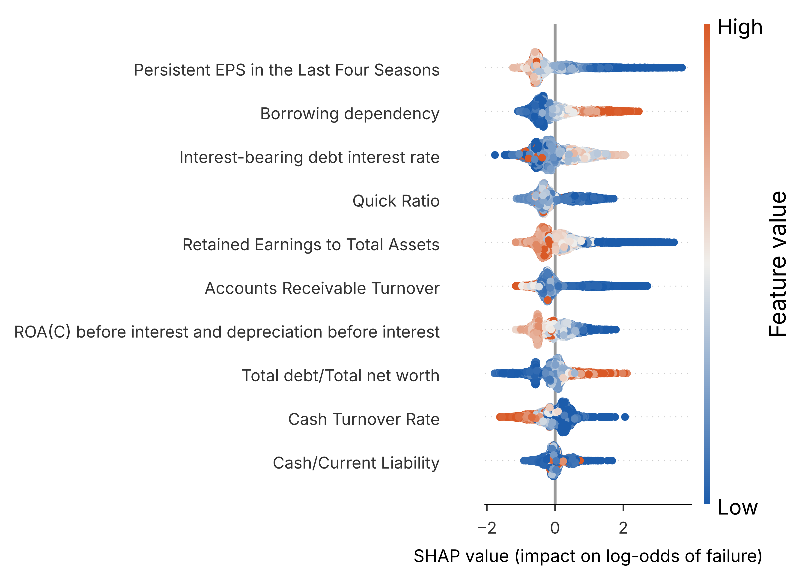

# XBP — explainable, cost-aware AI for business performance prediction

Code and data for the short communication

> **An Explainable Artificial Intelligence Framework for Data Analytics–Driven Business Performance Prediction**
> S.R. Banda — submitted to *Knowledge-Based Systems* (Elsevier).

XBP predicts corporate failure from financial ratios and turns the prediction into a
review decision that managers can audit. It chains four layers, each fitted on
training data only:

| Layer | What it does |
|---|---|
| **L1 Data analytics** | drops constant ratios and near-duplicates (\|Spearman ρ\| > 0.95) |
| **L2 AI prediction** | class-weighted gradient boosting (LightGBM) scores failure risk |
| **L3 Explainability** | **consensus SHAP**: averages normalized SHAP shares over the outer model and the inner cross-validation models, then keeps the top-k drivers as a compact model (single-model SHAP is reported as an ablation) |
| **L4 Decision** | learns the threshold that minimizes `c·FN + FP` from inner out-of-fold scores (exact O(n log n) search); compared with SMOTE and cost-sensitive training |

## Reproduce

```bash
pip install -r requirements.txt
python xbp.py           # full study: 5-fold x 3-repeat nested CV (~11 min on 2 CPUs)
python xbp.py --quick   # smoke test: 3-fold x 1 repeat (~2 min)
```

Every table, figure and number in the paper is written to `results/` by that one
command. Seeds are fixed, package versions are pinned, and the dataset's SHA-256
checksum is verified at load time.

| Option | Default | Meaning |
|---|---|---|
| `--cost-ratio` | `10` | cost of a missed failure ÷ cost of a false alarm |
| `--sensitivity` | `5 20` | extra cost ratios reported in Table 2 |
| `--k` / `--k-main` | `5 10 20` / `10` | driver counts tried / used by XBP |
| `--folds`, `--repeats` | `5`, `3` | outer repeated stratified CV |
| `--seed`, `--jobs` | `42`, `-1` | random seed, CPU cores |

## Results

Mean ± SD over 15 outer folds (5-fold × 3-repeat nested CV). Cost = expected
misclassification cost per 1,000 firms in units of one false alarm; flagging no firm
costs 322.6 at 10:1.

**Table 1 — benchmarks** (every model uses the L4 cost-aware threshold at 10:1;
XBP − model = mean per-fold cost difference with its 95% CI from the Nadeau–Bengio
corrected resampled t-test, positive = XBP costs more; Holm p = Holm-adjusted p of that test)

| Model | Ratios | ROC-AUC | PR-AUC | Recall | Cost per 1,000 firms | XBP − model [95% CI] | Holm p |
|---|---|---|---|---|---|---|---|
| Logistic regression | 65 | 0.933 ± 0.014 | 0.420 ± 0.051 | 0.738 ± 0.098 | 160.8 ± 23.0 | −2.5 [−32.5, +27.5] | 1.000 |
| Multilayer perceptron | 65 | 0.913 ± 0.053 | 0.390 ± 0.134 | 0.606 ± 0.146 | 181.9 ± 48.1 | −23.6 [−66.2, +19.1] | 1.000 |
| Random forest | 65 | 0.944 ± 0.011 | 0.458 ± 0.058 | 0.753 ± 0.062 | 145.8 ± 18.1 | +12.5 [−8.8, +33.8] | 1.000 |
| XGBoost | 65 | 0.941 ± 0.012 | 0.478 ± 0.058 | 0.759 ± 0.097 | 149.3 ± 21.9 | +9.0 [−9.9, +28.0] | 1.000 |
| LightGBM | 65 | 0.940 ± 0.012 | 0.483 ± 0.074 | 0.768 ± 0.084 | 148.0 ± 22.5 | +10.4 [−14.9, +35.6] | 1.000 |
| XBP (proposed) | 10 | 0.930 ± 0.020 | 0.441 ± 0.068 | 0.762 ± 0.095 | 158.3 ± 26.0 | — | — |

**Table 2 — decision strategies, ablation and cost sensitivity** (LightGBM in every row;
PR-AUC at 10:1; SMOTE replaces the class weight; cost-sensitive training weights each
failure by c and flags at 0.5; driver stability = mean pairwise Jaccard similarity of the
15 fold-level driver sets)

| Variant | Ratios | PR-AUC | Driver stability (Jaccard) | Cost, c = 5 | Cost, c = 10 | Cost, c = 20 |
|---|---|---|---|---|---|---|
| L1 + L2, default 0.5 threshold | 65 | 0.483 ± 0.074 | — | 93.4 ± 9.3 | 164.2 ± 18.9 | 306.0 ± 39.0 |
| + L4 cost-aware threshold | 65 | 0.483 ± 0.074 | — | 94.9 ± 12.2 | 148.0 ± 22.5 | 222.1 ± 36.6 |
| SMOTE + cost-aware threshold | 65 | 0.471 ± 0.078 | — | 102.4 ± 15.7 | 156.8 ± 17.3 | 223.5 ± 31.6 |
| Cost-sensitive training (weight = c) | 65 | 0.496 ± 0.073 | — | 104.9 ± 8.9 | 179.2 ± 21.8 | 325.1 ± 43.9 |
| + L3 consensus SHAP, top 20 | 20 | 0.470 ± 0.084 | 0.58 | 94.8 ± 11.1 | 154.2 ± 22.2 | 221.4 ± 40.7 |
| + L3 single-model SHAP, top 10 | 10 | 0.444 ± 0.064 | 0.56 | 101.5 ± 10.8 | 159.9 ± 24.4 | 231.0 ± 44.2 |
| + L3 consensus SHAP, top 10 (XBP) | 10 | 0.441 ± 0.068 | 0.56 | 101.3 ± 13.9 | 158.3 ± 26.0 | 246.4 ± 47.8 |
| + L3 consensus SHAP, top 5 | 5 | 0.407 ± 0.046 | 0.66 | 106.1 ± 10.5 | 165.3 ± 23.4 | 255.2 ± 31.7 |



*Fig. 1 — (a) mean cost per 1,000 firms by decision strategy; (b) paired cost differences with
corrected 95% CIs (filled = interval excludes zero).*

Key findings (corrected resampled t-tests, `summary.json` → `paired_tests`):

- **The decision threshold matters more than the learner.** Learning the threshold from
  business cost cut LightGBM's cost by 27.4% at 20:1 (95% CI 34.8–133.0 units,
  p = 0.003); the 9.9% cut at 10:1 was not significant (p = 0.25), and 5:1 gave no gain.
  The three full-feature tree ensembles differ by at most 3.5 cost units.
- **Where the cost enters matters.** SMOTE gave no further gain over the class weight
  (p ≥ 0.26); cost-sensitive training at the 0.5 threshold cost 103.0 units more than
  thresholding at 20:1 (p = 0.001).
- **10 ratios: no significant cost penalty, but not proven equivalent.** XBP's cost does not
  differ significantly from any 65-ratio benchmark (Holm p = 1.000), yet the 95% CIs allow
  a penalty of up to 35.6 units (24% of LightGBM's cost).
- **Consensus SHAP did not steady the drivers** (Jaccard 0.56, same as single-model SHAP;
  cost difference p ≥ 0.30). Seven ratios form a stable core chosen in ≥ 12 of 15 folds.



## Repository layout

```
xbp.py                 the whole method and experiment (data checks, 4 layers, nested CV, tables, figures)
data/bankruptcy.csv    UCI Taiwanese Bankruptcy Prediction dataset, unchanged
results/               table1_benchmark.csv, table2_ablation.csv, fold_metrics.csv,
                       summary.json, fig1_cost_effects.{pdf,png}, fig2_shap_drivers.{pdf,png}
```

## Data

6,819 Taiwanese listed firms (Taiwan Economic Journal, 1999–2009), 95 financial ratios,
220 failures (3.2%). Source: Liang et al. (2016), *European Journal of Operational
Research* 252, 561–572, distributed by the UCI Machine Learning Repository,
<https://doi.org/10.24432/C5004D>, under CC BY 4.0.
SHA-256: `67bf2e7c75490f7ad3f76bbce57d49cdc25967cdab607527b94f944863fa14d8`.

## Citation

```bibtex
@software{banda2026xbp,
  author = {Banda, Shashank Reddy},
  title  = {xai-business-performance: reproducible code for XBP},
  year   = {2026},
  url    = {https://github.com/shashankreddybanda/xai-business-performance}
}
```

## License

Code: MIT (see `LICENSE`). Data: CC BY 4.0, from the UCI Machine Learning Repository.
